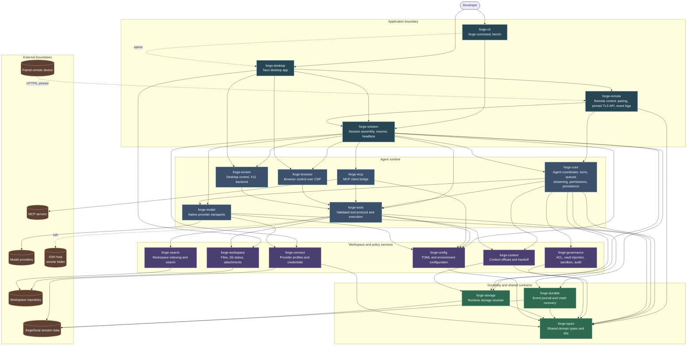

# Forge Architecture

Forge is a Rust workspace for an AI coding agent with a desktop app. The diagram below reflects the workspace crate boundaries and the primary request/turn lifecycle.

## Runtime flow

1. `forge-desktop` is the app: startup resolves the launch folder through the project registry, and its bridge (`src/bridge.rs`) routes every UI command to the right project's supervisor through `forge-session`'s `ProjectService`. `forge-cli` opens the app, or runs one headless prompt with `forge bench`.
2. `forge-session` assembles sessions: one `RepositorySupervisor` per open project (config, trust, owner lock, storage) for the app, or a single headless session for `forge bench`.
3. `forge-core` coordinates turns: it streams model output, validates and executes tools, applies governance checks, and journals durable events.
4. `forge-model` connects to model providers; `forge-mcp` connects external MCP servers; workspace tools operate on the repository through `forge-workspace` and `forge-search`.
5. `forge-durable` and `forge-storage` preserve resumable session state under repository-local `.forge/local/` storage (or the configured application-data fallback). A `.forge/local` is used only while Git tracks nothing in it (`forge-storage::local_dir`: one `git ls-files` per repository per process; when Git cannot tell, or `.forge` or `.forge/local` is a symbolic link Git would not look through, it is not used either): committed runtime state — a session list, journals — is not this machine's, so such a repository's state goes to application data, for writers and read-only callers alike, with a notice, and the committed files are left untouched.

6. `forge-remote` lets one paired device (a phone app, later) follow sessions
   live, send a prompt, stop a turn, and allow or deny a pending request. It
   is off until the user turns it on in Settings; then it serves a small
   HTTPS API (TLS 1.3, a self-signed certificate the device pins by
   fingerprint) on loopback or one chosen LAN address. `forge-desktop` owns
   the service (`src/remote.rs`); the crate reaches sessions only through its
   `RemoteBackend` trait, implemented over `ProjectService` by
   `SupervisorBackend` with the same supervisor commands the desktop sends.
   Which decisions a device may make comes from `forge-session::approvals`,
   which the desktop's approval card reads too: allow once, deny, or deny
   with a note, and only where the request offers that option without a
   privileged confirmation. A pairing code lives only in memory, works once
   and expires; redeeming it opens a pairing request the desktop must allow
   against a confirmation number both screens show, and only then is a
   token created, stored only as a SHA-256. Each followed
   session has an event log with contiguous sequence numbers (`hub`), so a
   device sees events in order and resumes after a reconnect without a
   silent gap. A session event carries only the newest 30 messages (older
   ones are paged), and streamed text is batched every 50 ms, so an update
   costs the same however long the conversation. The wire format is
   `crates/forge-remote/PROTOCOL.md`.

Execution targets decide where a session's tools run. `forge-tools::target`
defines the `Target` trait every workspace tool goes through (`bash`,
background jobs, `exec_command`/`write_stdin`, the file tools, `glob`/`grep`
and `git`): `LocalTarget` is this machine under the sandbox, as before, and
`SshTarget` a host from the user's SSH config and a folder on it. An SSH
command is a local `ssh` process over the session's `ControlMaster`
connection, so it uses the same spawn, output, yield and PTY code; a small
`bash` wrapper on the host records its process group (for cancel) and exit
status (to tell an exit of 255 from a lost connection). File operations go to a pool of up to four long-lived helpers on the host
(`forge-tools::target::helper`: a `bash` loop reading length-prefixed requests,
one network round trip each), falling back to one SSH command per operation on
a host without `base64`. File tools resolve and
confine paths on the host; `glob`/`grep` use `rg` there when it is installed,
`find`/`grep` otherwise, in the local tools' output shape. The target
(`forge_types::ExecutionTarget`) is saved on the session's control row
(`sessions.target`, ownership `remote`); `forge-session` connects and checks
the host before a remote session is created, points a reopened session back at
it (connecting on first use), and closes it with the session. `forge-core`
applies it to the session: approvals name the host, "ask before each command"
gates commands through `forge-governance`, the unconfined retry is withdrawn,
the system prompt says where commands run, and only read-only child agents
start. `forge-desktop` lists hosts from `~/.ssh/config` and refuses its
local-only commands (files, Git, terminal, GitHub) for a remote session.

Built-in tool schemas are generated from each tool's argument type and
passed through `forge_tools::compact_schema` (the shared `schema_for`
helper): the generator's boilerplate (`$schema`, titles, `default: null`,
number formats such as `uint32`) is removed and `$defs` are written in place,
which saves about 700 tokens on every request. The compacted schema is also
what calls are validated against; `schema_tests` checks that every built-in
still accepts and refuses exactly what its generated schema did. MCP tools'
schemas come from their servers and are sent as they are.

Browser and desktop control span the layers too. `forge-browser` finds an
installed Chromium-family browser, starts it per session with a fresh profile
and `--remote-debugging-pipe`, routes its traffic through a labelled endpoint
of the session's egress gateway, and exposes the `browser_*` tools (a page is
read by `snapshot.js` in an isolated world). `forge-screen` puts the platform
behind one `ScreenBackend` trait (Linux X11 via `x11rb`: core-protocol capture,
XTEST input, RandR, X-Resource owner pids; macOS is a stub) and exposes the
`desktop_*` tools with the screen lease, takeover detection and the
Forge-window guard. A tool that needs the user's say-so returns
`ToolError::ConsentRequired`; `forge-core` turns it into an approval (never
answered by approve-all), records grants in the session's `SessionConsents`,
hides tools that are switched off or need image input, keeps them from built-in
children, and sends only the latest screenshots. Each opened session owns its
browser, desktop, and web-check handles (a child shares its parent's); saved
settings are applied to the sessions a project still has open.
`forge-config` owns the user-only `[browser]`/`[desktop]` sections.

Web check spans them as well. `forge-sandbox`'s `SandboxPolicy::with_ingress`
binds a private directory into the sandbox and starts a socat relay there
(`UNIX-LISTEN` on `app.sock` → the app's loopback port) before the command.
`forge-tools` owns the host side: `ingress::IngressRelay` (a random
`127.0.0.1` port joined to that socket, opened without following links) and
`web_app` (the `AppRunner` that spawns the app confined, its bounded log, and
the per-session `WebAppSlot` the tools share). `forge-core` intercepts
`app_start`/`app_stop` like `background_run`: the app is a background task of
kind `App` (stopping it on purpose succeeds, exiting by itself fails), and a
`web_check` result becomes a verification signal of the turn.
`forge-browser`'s `checker` drives a separate headless browser whose only
direct route is the app's address (everything else meets `deny_proxy`), and
`web_check` declares the three tools and turns page reports into the answer.
`forge-session`'s `ComputerUse` registry installs them with the project's
`[web]` section and the user-only `[web_check]` switch; the desktop app shows
the app in Activity and opens it only through `open_app`.

Custom agents span the layers: `forge-config::agents` owns the file format,
both scopes, validation and the capability rules; `forge-core::custom_agents`
lists agents in the system prompt, turns `spawn_agent` into a child's tool
limit, network and model, and journals that profile in the child's journal;
`forge-session` validates a requested model against the providers and catalog;
`forge-desktop` exposes list/save/delete commands to Settings.

Model tiers (`fast`, `default`, `strong`) name a provider/model/effort
combination without naming a model, and are never configured by the user.
`forge-connect::tiers` ranks each provider's models for every tier from
models.dev metadata (price, release date, reasoning, effort levels): the
newest generation of each model line (older generations follow it as
fallbacks for accounts without the newest), `fast` cheapest first, `default`
the median-priced, `strong` the priciest reasoning model; experimental,
preview, beta, speech and realtime models are never picked. A model
models.dev does not list still moves its effort for a tier, by Forge's own
effort rules.
`forge-session::model_tiers` stores the rankings in one user-level SQLite
table (`<Forge data dir>/model-tiers.db`) shared by every project and kept
across restarts. It is built off the request path — once while a provider is
connected (the only wait), then in the background when models.dev, a
provider definition, or Forge itself changes — and each provider carries a
fingerprint of its inputs, so only changed providers are re-ranked and only
changed rows written. Sessions load the table into memory when they open; a
tier is then a memory lookup: the first ranked model the account can run.
In `forge-core::tiers`, the model
asks for a tier with `set_model_tier` (top-level sessions, when the user's
message asks for it; it lasts for that turn) or with `spawn_agent`'s `tier`
(a child's tier for its life). When the completion evaluator fails a subagent
turn, the turn is re-run once on the strong tier in the same child and
worktree.

Every finished turn — top-level or subagent — writes one row to the
`turn_records` table in its session's own journal (`forge-core::turn_record`,
stored by `forge-durable`): session and parent, model, effort, tier, outcome
and completion reason, whether it escalated or is an escalation's retry,
tokens, duration and time spent waiting on the user, and the turn's signals
(approvals requested, granted and denied; questions; messages the user sent
while it ran; verification commands passed, failed or unfinished; tool
failures; provider and runtime errors; cancellation by the user,
interruption by a parent or a restart; compaction; tier switches;
escalation). Every frontend that drives turns ends a turn an error stopped
through `AgentSession::fail_turn_on_error`, so no turn is left open and
unrecorded. Like the audit table, it is a local record that resume never
reads.

Each turn record also names its task kind (`forge_types::TaskKind`): `main`
for a top-level session, `subagent` for a built-in child (writer or
read-only), `custom:<name>` for a child started as a custom agent. A session
knows its kind from how it was built: `create` is `main`, `create_child`
takes it from the spawn's profile, and a session reopened from its journal
(`resume`, `resume_session`, `resume_child`) takes it from the journal's
agent profile. A journal from before kinds existed gains the `task_kind`
column when it is opened, its rows filled in by the same rule
(`forge_durable::kind_from_journal`).

`forge-session::model_report` reads those records back for `forge models
report`.

- **Whose journals.** Everything that reads a workspace's journals outside
  a session — this report and the model ranking below — lists them through
  `forge-session::workspace_journals::WorkspaceJournals`, which holds the
  rules in one place. The workspace's own journals are read only when the
  workspace is trusted — the same trust `LaunchPlan` requires before any
  session runs, so journals in an untrusted folder are not the user's (they
  could have been committed to the repository). An explicitly named,
  absolute journal directory needs no trust. The directory is found without
  creating it, by the same resolver sessions write through (`journal_dir`;
  `RuntimeStorage::path_for_existing`): the repository-local one, or the
  application-data fallback when that is where a repository Forge could not
  write to keeps its sessions.
- **Reading.** Every `<session>.db` there is read without being changed
  (`forge_durable::scan_turn_records`): immutable when no session has the
  journal open, so not even SQLite's `-wal`/`-shm` files appear; through the
  WAL when one does, so its latest rows are seen (a session opening an idle
  journal at that instant can make one read stale, never harm the journal).
  Rows are streamed a page at a time into running totals, only the columns
  the report uses, with the `--since` and `--kind` filters applied in the
  query; several journals are read at a time. Entries that are symbolic
  links, journals the repository tracks (`forge_storage::tracked_files`:
  committed, so not sessions run here — and when Git cannot tell, none is
  read), and journals with a value the report uses that does not decode (an
  error, never a panic), are skipped and listed.
- **Ranking.** Turns are grouped by kind and by (model, provider, effort) —
  old provider names read as today's profile ids — and ranked per kind on
  seven measures (completion, escalation, verification pass rate, approval
  rate, queued messages, median tokens, median active time) by mean rank,
  with a neutral rank for a measure a group has no data for; groups below
  the minimum turn count are listed, unranked.
- **Output.** The CLI prints names with control characters escaped: they
  come from journals and provider catalogs, and must not drive the terminal.

The same ranking chooses the model of a subagent started without a tier or a
model. `forge-core` asks a `SubagentModelAdvisor` — installed by the
session's owner, like the tier resolver — from `subagent_spec_for`, only when
`spawn_agent` names no tier, model or effort, with the child's kind and the
parent's own model; the answer (a model or none, and a `ModelChoice`: source,
reason, evidence) goes into the child's profile, so it is journaled with the
`AgentProfile` and survives a resume, and comes back in the `spawn_agent`
result and as a `model_chosen` signal on each of the child's turns.
`forge-session::subagent_models` is the advisor `open_session_with_model`
installs (not for the offline mock), reading the ranking kept by
`forge-session::model_ranking`: a `model_report::RankingSnapshot` of the
last 90 days, shared by the project's sessions, built and rebuilt (after 60 s)
in the background so a spawn never waits. Rebuilds are incremental
(`JournalRanking` keeps each journal's totals with the size and time of its
`.db` and `-wal`, and reads again only the journals that changed; every
journal at most hourly, which moves the window), and the snapshot holds each
group's worked-out numbers, so advising a spawn costs the same whatever the
history's length; the kind ranked over the parent's
provider's models the account can run (the tier table's runnable list); a
pick needs 20 turns and two ranked candidates, and goes through the same
child-model resolver as an explicit model; about one spawn in ten explores.
The same ranking chooses the main session's model per turn when the user
picks **Auto** (`forge-core::models::auto`; the decisions are made by
`AutoController::on_turn_start`/`on_turn_end`, which hold no session, and
the session applies them). `choose_auto_model`, run as each
turn starts (`transition_to_new_task`, before the first model request), asks
the session's `AutoModelAdvisor` for the start — the ranked best for `main`
work on the fallback's provider (`forge-session::auto_models`, sharing
`model_ranking`'s ranking, cache, thresholds and rules with subagents, without
exploration), or the fallback — builds the step-up ladder from it (`ladder`:
the start's higher efforts from the catalog, then the tier resolver's strong
model and its efforts), and puts the turn on the current step; the decision
is an `auto_model` signal and an `AutoModel` journal event. When the turn is
recorded, `move_auto_model` steps up after a failure the completion evaluator
found (not a provider or runtime error, not denied approvals), down after two
successes in a row, and not at all for a turn on a user-requested tier; a
failed turn is never re-run. Auto (fallback, position, decisions) is replayed
from the journal on resume; the supervisor's `SetAutoModel` turns it on and
keeps the fallback as the session's model on its control row, and `SetModel`
turns it off. The desktop shows each Auto turn's choice from the session
details' `auto_decisions`, anchored to the user message that started it.
The `[subagents] model_selection` switch (`ranked` or `inherit`) is a
privileged key; an untrusted workspace's journals are never read, and trust
is checked again at every rebuild (a failed build drops the ranking rather
than keep using it). Only candidates with a known effort name are ranked, so
every name in a reason — which the parent agent reads — comes from the
account's runnable models or Forge's own vocabulary, never from a journal.

`forge-types` is the shared contract layer. `forge-test-support` is intentionally omitted from the runtime diagram because it is test-only infrastructure.
