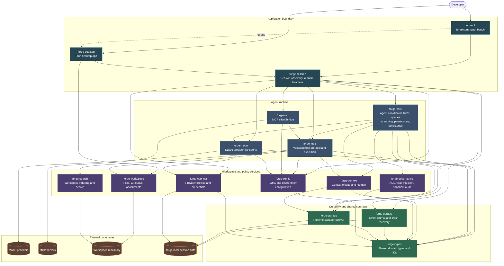

# Forge Architecture

Forge is a Rust workspace for an AI coding agent with a desktop app. The diagram below reflects the workspace crate boundaries and the primary request/turn lifecycle.

## Runtime flow

1. `forge-desktop` is the app: startup resolves the launch folder through the project registry, and its bridge (`src/bridge.rs`) routes every UI command to the right project's supervisor through `forge-session`'s `ProjectService`. `forge-cli` opens the app, or runs one headless prompt with `forge bench`.
2. `forge-session` assembles sessions: one `RepositorySupervisor` per open project (config, trust, owner lock, storage) for the app, or a single headless session for `forge bench`.
3. `forge-core` coordinates turns: it streams model output, validates and executes tools, applies governance checks, and journals durable events.
4. `forge-model` connects to model providers; `forge-mcp` connects external MCP servers; workspace tools operate on the repository through `forge-workspace` and `forge-search`.
5. `forge-durable` and `forge-storage` preserve resumable session state under repository-local `.forge/local/` storage (or the configured application-data fallback).

Custom agents span the layers: `forge-config::agents` owns the file format,
both scopes, validation and the capability rules; `forge-core::custom_agents`
lists agents in the system prompt, turns `spawn_agent` into a child's tool
limit, network and model, and journals that profile in the child's journal;
`forge-session` validates a requested model against the providers and catalog;
`forge-desktop` exposes list/save/delete commands to Settings.

Model tiers (`fast`, `default`, `strong`) name a provider/model/effort
combination without naming a model, and are never configured by the user.
`forge-connect::tiers` ranks each provider's models for every tier from
models.dev metadata (price, release date, reasoning, effort levels): the
newest generation of each model line (older generations follow it as
fallbacks for accounts without the newest), `fast` cheapest first, `default`
the median-priced, `strong` the priciest reasoning model; experimental,
preview, beta, speech and realtime models are never picked. A model
models.dev does not list still moves its effort for a tier, by Forge's own
effort rules.
`forge-session::model_tiers` stores the rankings in one user-level SQLite
table (`<Forge data dir>/model-tiers.db`) shared by every project and kept
across restarts. It is built off the request path — once while a provider is
connected (the only wait), then in the background when models.dev, a
provider definition, or Forge itself changes — and each provider carries a
fingerprint of its inputs, so only changed providers are re-ranked and only
changed rows written. Sessions load the table into memory when they open; a
tier is then a memory lookup: the first ranked model the account can run.
In `forge-core::tiers`, the model
asks for a tier with `set_model_tier` (top-level sessions, when the user's
message asks for it; it lasts for that turn) or with `spawn_agent`'s `tier`
(a child's tier for its life). When the completion evaluator fails a subagent
turn, the turn is re-run once on the strong tier in the same child and
worktree.

Every finished turn — top-level or subagent — writes one row to the
`turn_records` table in its session's own journal (`forge-core::turn_record`,
stored by `forge-durable`): session and parent, model, effort, tier, outcome
and completion reason, whether it escalated or is an escalation's retry,
tokens, duration and time spent waiting on the user, and the turn's signals
(approvals requested, granted and denied; questions; messages the user sent
while it ran; verification commands passed, failed or unfinished; tool
failures; provider and runtime errors; cancellation by the user,
interruption by a parent or a restart; compaction; tier switches;
escalation). Every frontend that drives turns ends a turn an error stopped
through `AgentSession::fail_turn_on_error`, so no turn is left open and
unrecorded. Like the audit table, it is a local record that resume never
reads.

`forge-types` is the shared contract layer. `forge-test-support` is intentionally omitted from the runtime diagram because it is test-only infrastructure.
